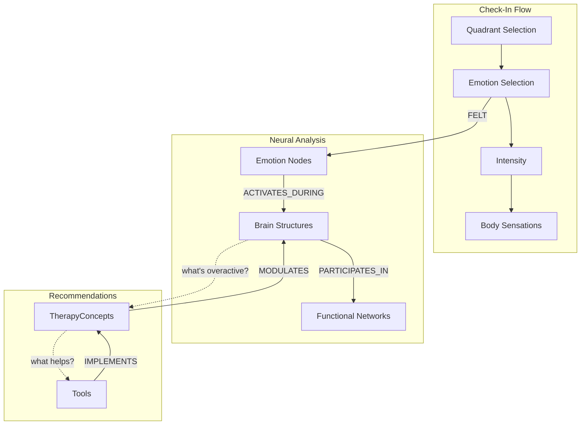

# Neuroscience-Powered Smart Recommendations

## Core Philosophy

**This is NOT another emotion tracking app.** The goal is:

1. **Solutions-focused**: Help users find what will actually help, immediately
2. **Reduce cognitive load**: Users are already overwhelmed - don't add more
3. **Affect labeling**: Build emotional vocabulary and mentalization skills
4. **Neural mechanism targeting**: Recommend based on brain science, not just symptom matching

---

## The Recommendation Engine

### How It Works




### The Graph Traversal

**Step 1: User checks in with emotions**

```
User feels: Anxious, Overwhelmed
```

**Step 2: Identify neural activation pattern**

```cypher
// Find what brain structures are likely activated
MATCH (e:Emotion)<-[:FELT]-(ci:CheckIn {id: $checkInId})
MATCH (bs:BrainStructure)-[:ACTIVATES_DURING]->(e)
RETURN bs.id, bs.name, collect(e.name) AS emotions
```

Result:

- Amygdala (anxious, overwhelmed)
- BNST (anxious - sustained/anticipatory)
- Anterior Insula (anxious)

**Step 3: Find tools that target these structures**

```cypher
// Find therapy concepts that modulate overactive structures
MATCH (bs:BrainStructure {id: "amygdala"})
MATCH (tc:TherapyConcept)-[:MODULATES {direction: "down-regulates"}]->(bs)
MATCH (t:Tool)-[:IMPLEMENTS]->(tc)
RETURN t.name, t.emoji, tc.name AS mechanism, tc.id
```

Result:

- Cool Down (TIP - Temperature) - "down-regulates amygdala via dive reflex"
- Pause (STOP Skill)

---

## Key Data Model Changes

### 1. Tool Nodes (seed from tools.ts)

```cypher
CREATE (t:Tool {
  id: "cool-down",
  name: "Cool Down",
  emoji: "🧊",
  categoryId: "help-right-now",
  subcategoryId: "quick-calming"
})

// Link to existing TherapyConcept
MATCH (t:Tool {id: "cool-down"}), (tc:TherapyConcept {id: "dbt_tipp"})
CREATE (t)-[:IMPLEMENTS]->(tc)
```

Tool → TherapyConcept mappings:

- `cool-down` → `dbt_tipp` (down-regulates amygdala)
- `five-senses` → `mindfulness` / grounding (strengthens insula, pfc)
- `pause` → `dbt_stop` 
- `urge-surfing` → `dbt_distress_tolerance`
- `name-it` → emotion labeling (activates dlPFC)
- `opposite-action` → `dbt_opposite_action`
- `let-it-be` → `dbt_radical_acceptance`
- `one-good-thing` → `cbt_behavioral_activation` (increases dopamine)

### 2. Link Check-Ins to Emotion Nodes

Current: `CheckIn.emotion = "Anxious, Stressed"` (string)

New:

```cypher
// When saving check-in, also create relationships
MATCH (e:Emotion) WHERE e.name IN $emotionNames
CREATE (ci)-[:FELT]->(e)
```

### 3. Neural Profile Tracking (Over Time)

```cypher
// Track which brain structures are repeatedly implicated
CREATE (np:NeuralProfile {
  userId: $userId,
  updatedAt: datetime()
})

// After each check-in, update activation frequencies
MATCH (u:User {id: $userId})-[:HAS_PROFILE]->(np:NeuralProfile)
MATCH (ci:CheckIn)-[:FELT]->(e:Emotion)
MATCH (bs:BrainStructure)-[:ACTIVATES_DURING]->(e)
SET np[$bs.id + "_count"] = coalesce(np[$bs.id + "_count"], 0) + 1
```

---

## Non-Obvious Recommendations (The Hippocampus Example)

### The Insight

When amygdala fear response is chronically overactive:

- Hippocampus gets suppressed (documented in anxiety/PTSD)
- Direct approach: calm the amygdala (TIP, grounding)
- **Indirect approach**: activate hippocampus directly

Hippocampus activates during:

- Spatial navigation / map-based activities
- Memory consolidation
- Contextual processing

### Implementation

```cypher
// Detect chronic amygdala hyperactivity
MATCH (u:User {id: $userId})-[:HAS_PROFILE]->(np:NeuralProfile)
WHERE np.amygdala_count > 10 AND np.amygdala_count > np.total_checkins * 0.5

// Find structures that are suppressed by amygdala overactivity
// (This relationship needs to be added to schema)
MATCH (amyg:BrainStructure {id: "amygdala"})-[:SUPPRESSES_WHEN_OVERACTIVE]->(target:BrainStructure)

// Find activities that activate the suppressed structure
MATCH (tc:TherapyConcept)-[:ACTIVATES]->(target)
RETURN tc.name, target.name AS targetStructure, 
       "Try this to activate " + target.name AS rationale
```

### Potential Indirect Interventions


| Pattern Detected                      | Suppressed Structure | Indirect Strategy                                      |
| ------------------------------------- | -------------------- | ------------------------------------------------------ |
| Chronic amygdala hyperactivity        | Hippocampus          | Map-based activities, memory games, spatial navigation |
| Chronic DMN overactivity (rumination) | CEN                  | Goal-directed tasks, working memory exercises          |
| Chronic hypoarousal                   | Thalamus             | Sensory engagement, movement                           |
| Low nucleus accumbens activation      | -                    | Behavioral activation, pleasant activities             |


---

## Recommendation API Design

### `getToolRecommendations(checkInId)`

```typescript
interface ToolRecommendation {
  tool: Tool;
  mechanism: string;           // "down-regulates amygdala"
  confidence: "high" | "medium";
  rationale: string;           // "Based on anxiety, your amygdala is likely overactive"
  type: "direct" | "indirect"; // indirect = non-obvious strategy
}
```

**Response example:**

```json
{
  "recommendations": [
    {
      "tool": { "id": "cool-down", "name": "Cool Down", "emoji": "🧊" },
      "mechanism": "Triggers dive reflex, activates vagus nerve",
      "confidence": "high",
      "rationale": "When you're feeling anxious, your amygdala is working overtime. Cold temperature quickly calms it down.",
      "type": "direct"
    },
    {
      "tool": { "id": "five-senses", "name": "5-4-3-2-1", "emoji": "👁️" },
      "mechanism": "Engages prefrontal cortex, grounds in present",
      "confidence": "high", 
      "rationale": "Grounding brings your thinking brain back online.",
      "type": "direct"
    }
  ],
  "neuralContext": {
    "likelyActivated": ["amygdala", "anterior_insula", "bnst"],
    "likelySuppressed": ["dlpfc", "hippocampus"],
    "dominantNetwork": "salience_network"
  }
}
```

---

## UX Flow

### After Check-In Completion

1. User completes check-in (quadrant → emotions → intensity → body)
2. **NEW**: Instead of just "Done" or "Find tools", show:

```
┌─────────────────────────────────────────┐
│  Based on what you're feeling...        │
│                                         │
│  Your brain is likely in "high alert"   │
│  mode right now. Here's what might      │
│  help:                                  │
│                                         │
│  🧊 Cool Down                           │
│  Quickly calms your nervous system      │
│  [Try this →]                           │
│                                         │
│  👁️ 5-4-3-2-1                           │
│  Brings your thinking brain back online │
│  [Try this →]                           │
│                                         │
│  ────────────────────────────           │
│  [Skip for now]  [See all tools]        │
└─────────────────────────────────────────┘
```

### Key UX Principles

- **Don't overwhelm**: 2-3 recommendations max
- **Explain the "why"**: Brief, non-clinical language
- **Reduce friction**: One tap to start the tool
- **No pressure**: Easy to skip or explore

---

## Schema Additions Needed

### New Relationships to Add

```cypher
// Tool implements TherapyConcept
(Tool)-[:IMPLEMENTS]->(TherapyConcept)

// Track what gets suppressed when structure is overactive
// (For indirect recommendation logic)
(BrainStructure)-[:SUPPRESSES_WHEN_OVERACTIVE]->(BrainStructure)
// e.g., (amygdala)-[:SUPPRESSES_WHEN_OVERACTIVE]->(hippocampus)
// e.g., (amygdala)-[:SUPPRESSES_WHEN_OVERACTIVE]->(dlpfc)

// Network imbalance patterns
(FunctionalNetwork)-[:IMBALANCED_WITH {pattern: "hyperactive"}]->(FunctionalNetwork)
// e.g., Salience Network hyperactive → CEN hypoactive
```

### New Properties on Existing Nodes

```cypher
// Add activation type to ACTIVATES_DURING relationships
(bs)-[:ACTIVATES_DURING {direction: "increases" | "decreases"}]->(e)

// Add mechanism details to MODULATES
(tc)-[:MODULATES {
  direction: "down-regulates" | "up-regulates" | "strengthens",
  mechanism: "dive reflex, vagal activation"
}]->(bs)
```

---

## Files to Modify

### Cloud Functions ([functions/src/index.ts](functions/src/index.ts))

Add:

- `getToolRecommendations(checkInId)` - the core recommendation engine
- `getNeuralProfile(userId)` - get user's chronic activation patterns
- `updateNeuralProfile(userId, checkInId)` - update after each check-in

Modify:

- `saveCheckIn()` - add `(CheckIn)-[:FELT]->(Emotion)` relationships

### Schema ([schema/](schema/))

Add:

- `seed-tools.cypher` - create Tool nodes and IMPLEMENTS relationships
- `neural-suppression.cypher` - add SUPPRESSES_WHEN_OVERACTIVE relationships
- Migration to link existing check-ins to Emotion nodes

### Frontend

- `CheckIn.tsx` - show recommendations after completion
- New component: `ToolRecommendations.tsx` - display recommended tools with rationale

---

## Future: Functional Network Tracking

Once we have enough data:

```cypher
// Identify problematic network patterns for a user
MATCH (u:User {id: $userId})-[:HAS_PROFILE]->(np:NeuralProfile)
MATCH (bs:BrainStructure)-[:PARTICIPATES_IN]->(fn:FunctionalNetwork)
WHERE np[bs.id + "_count"] > 5
WITH fn, sum(np[bs.id + "_count"]) AS networkActivation
ORDER BY networkActivation DESC
RETURN fn.name, networkActivation
```

This enables:

- "Your Salience Network tends to be very active"
- "You might benefit from practices that strengthen your Central Executive Network"
- Longer-term, network-level intervention suggestions

